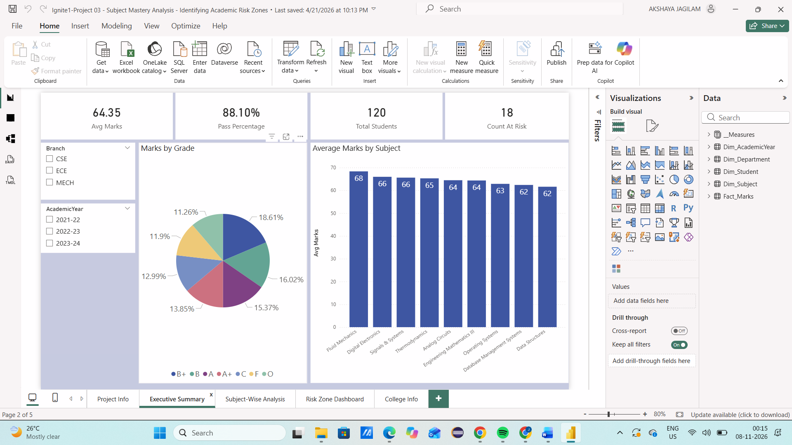

Subject Mastery Analysis: Academic Risk Zones

## Project Overview
Subject Mastery Analysis is a Power BI dashboard developed to analyze student academic performance and identify academic risk zones. It helps understand subject-wise performance trends and identify students who may need additional academic support.

## Objectives
- Analyze student academic performance.
- Identify low-performing students.
- Compare subject-wise performance.
- Highlight academic risk areas through interactive visualizations.

## Tools & Technologies
- Power BI Desktop
- Power Query
- Microsoft Excel

## Key Features
- Interactive academic performance dashboard.
- Subject-wise performance analysis.
- Identification of academic risk zones.
- Student performance comparisons.
- Data cleaning and transformation using Power Query.

## Dataset
The project uses an Excel dataset containing student academic performance records.

## Project Files
- `Ignite1-Project 03 - Subject Mastery Analysis - Identifying Academic Risk Zones.pbix` – Power BI dashboard.
- `SubjectMastery_PowerBI_Data.xlsx` – Supporting dataset.

## How to View
1. Download the `.pbix` file from this repository.
2. Open it using Microsoft Power BI Desktop.
3. Explore the interactive dashboard.

## Project Outcome
The dashboard provides insights into student performance and helps identify academic areas requiring improvement.

## Dashboard Preview

